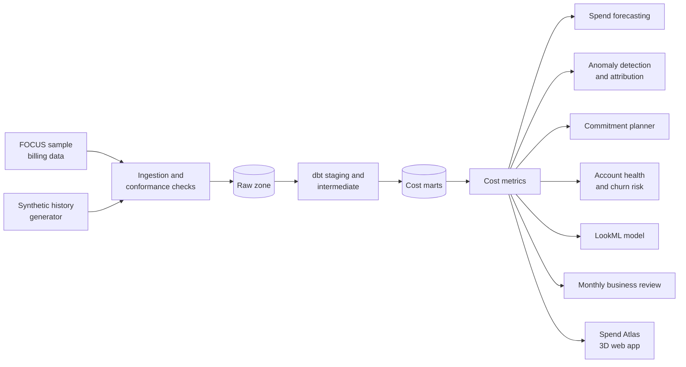

# cloud-finops-analytics

[](https://github.com/mohammadazam7/cloud-finops-analytics/actions/workflows/ci.yml)

Cloud cost and consumption analytics on billing data in the FinOps Foundation's FOCUS
format: where the money goes, where it is heading, why it moved, and how much a
commitment would save.

> **Status:** in development. FOCUS ingestion, the dbt cost models and the governed
> metric layer, forecasting, anomaly detection and attribution of a change in spend to
> its drivers are in place; commitment planning is next. See the
> [roadmap](docs/ROADMAP.md) for milestone dates.

## Results at a glance

Measured on the seeded synthetic 24-month history (labelled synthetic, not a real bill)
plus the FinOps Foundation FOCUS sample:

| What | Value |
|---|---|
| Synthetic effective cost, 24 months | 5,921,698 USD |
| Synthetic effective savings rate (1 minus effective over list cost) | 37.7% |
| AWS savings plan utilization / coverage | 99.8% / 83.6% |
| Unused AWS commitment | 3,916 USD |
| dbt build (models, contracts and tests) | 42 of 42 pass |
| Planted cost anomalies found (synthetic) | 17 of 18 |
| Anomaly incidents raised that match a planted anomaly | 17 of 21 |

The anomaly detector compares each day's cost per account, service and region with a
robust baseline (median and median absolute deviation of the previous 28 days). All
four incidents that match no planted anomaly are lasting step changes, where a series'
cost rose and stayed up (CloudWatch in one account went from about 10 to 50 USD a day);
the generator plants those as workloads moving between services, and they are worth an
alert even though they are not spikes. The one planted anomaly it missed is on a series
costing 0.22 USD a day, where the whole spike is under the 1 USD a day minimum excess.

### Why did it move?

`finops_analytics.attribution.explain` splits a change in spend between accounts,
services, regions or SKUs. On the synthetic history, for the three days of the largest
planted anomaly:

```text
2025-07-08 to 2025-07-10: 32,223.79 against 24,596.48 expected (+7,627.31), by account and service
  100000000000 / Amazon Elastic Compute Cloud     +6,630.44   86.9% of the change
  100000031676 / Amazon Elastic Compute Cloud       +280.34    3.7% of the change
  100000039595 / Amazon Elastic Compute Cloud       +161.44    2.1% of the change
  100000015838 / Amazon Elastic Compute Cloud       +146.78    1.9% of the change
  121 others                                        +408.32
```

Each value is compared with its mean cost on the same weekdays in the previous 28 days.
The mean is used because means add up, so the lines always sum to the total and nothing
is left unexplained. The same weekday is used because spend has a weekly rhythm: against
a plain four-week average, every weekend looks like a fall in the largest service.

How well it points at the cause, measured on the 18 planted anomalies by asking what
drove total spend on each one's days:

| | Same-weekday baseline | Plain 28-day mean |
|---|---|---|
| Planted series is the top driver | 10 of 18 | 8 of 18 |
| Planted anomalies of 100 USD or more in the top two | 11 of 11 | 11 of 11 |
| Planted anomalies under 30 USD in the top five | 0 of 6 | 0 of 6 |

Attribution answers what moved the total, so a 9 USD spike is buried under the ordinary
movement of a service that costs thousands a day. Small anomalies are the detector's
job, one series at a time; the two tools are meant to be used together.

## What this demonstrates

- Billing data modelled to the FOCUS specification, with conformance checks on input.
- A dbt project with typed staging, enforced contracts, an incremental fact with a
  restatement window, and tests that reconcile marts back to source.
- A governed metric layer: one YAML definition per metric, compiled to SQL at any
  grain, with ratios always computed from additive parts.
- Decisions recorded as ADRs: [rollups from additive parts](docs/adr/0001-roll-up-from-additive-parts.md)
  and [the incremental lookback](docs/adr/0002-incremental-cost-fact-with-lookback.md).

## Overview

Cloud bills are large, granular and hard to read. Finance sees one invoice total,
engineering sees resource usage, and account teams see a customer's consumption trend;
none of them sees the same number. Spikes are found weeks late, and commitment purchases
are sized by instinct rather than by the usage they are meant to cover.

This project builds the analytics layer that answers four questions from one set of
tested models:

1. **Where does the money go?** Cost by service, account, region and SKU, on billed,
   effective and amortized bases, reconciled to the invoice total.
2. **Where is it heading?** A spend forecast per service with prediction intervals,
   evaluated on past months it did not see.
3. **Why did it move?** Anomaly detection that attributes each spike to the service,
   account, region or SKU behind it.
4. **What would a commitment save?** A planner that recommends a commitment level from
   the usage distribution, with the expected saving and the risk of paying for unused
   commitment.

A sales-operations view adds account health: which customers are expanding, flat or
contracting, and which show early signs of churn.

The input is the FinOps Foundation's FOCUS sample billing data, extended with a seeded
synthetic multi-account history where the sample is too short for forecasting. Every
table and chart states which source it comes from.

## Architecture



| Layer | Responsibility |
|---|---|
| Ingestion | Load FOCUS files, check them against the specification (required columns, types, allowed values, cost identities), and record what failed |
| dbt models | `fct_cost_daily`, `fct_commitment_utilization`, `dim_service`, `dim_account`, `dim_region`, `dim_sku`; incremental, partitioned by charge date and clustered by service and account |
| Cost metrics | Billed, effective and amortized cost, unit cost, commitment coverage and utilization, savings rate |
| Analytics | Forecasting with backtests, anomaly detection with attribution, commitment planning, account health |
| Reporting | LookML model, automated monthly business review, interactive 3D app |

SQL is written in the BigQuery dialect. Continuous integration runs the same dbt models
on DuckDB, so every change is built and tested without cloud credentials; a BigQuery
target deploys them unchanged.

## Getting started

```bash
python -m venv .venv && source .venv/bin/activate
make install
make check
finops download                     # FOCUS sample, pinned commit, checksum verified
finops check data/focus-sample/focus_sample_100000.csv.gz
```

Build the warehouse and query a governed metric:

```bash
make data                                  # FOCUS sample and synthetic history
make models                                # dbt build on DuckDB
finops metric commitment_utilization --by provider
finops metric effective_cost --by month --by service_category
finops metric effective_cost --by team --sql   # print the SQL instead
```

Definitions live in [metrics/metrics.yml](metrics/metrics.yml); the
[metric dictionary](docs/metric_dictionary.md) and the
[architecture notes](docs/architecture.md) explain each one.

`finops check` reports every rule a file breaks, with the row count, example values and
whether the problem can be repaired safely. On the FinOps Foundation's 100,000-row
sample it finds 6 errors (for example 27 rows with no `ServiceCategory` and 4 with no
`BillingCurrency`) and 6 repairable issues (for example 683 rows that spell
`ChargeFrequency` as `Usage-based`).

## License

MIT. The FOCUS sample data is published by the FinOps Foundation under its own licence;
it is downloaded by a script and not redistributed in this repository.
