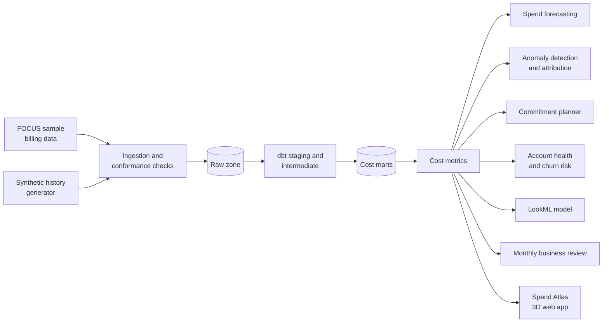

# cloud-finops-analytics

[](https://github.com/mohammadazam7/cloud-finops-analytics/actions/workflows/ci.yml)

Cloud cost and consumption analytics on billing data in the FinOps Foundation's FOCUS
format: where the money goes, where it is heading, why it moved, and how much a
commitment would save.

> **Status:** in development. The project foundation is in place; see the
> [roadmap](docs/ROADMAP.md) for milestone dates. Results will be published here only
> once they have been measured.

## Overview

Cloud bills are large, granular and hard to read. Finance sees one invoice total,
engineering sees resource usage, and account teams see a customer's consumption trend;
none of them sees the same number. Spikes are found weeks late, and commitment purchases
are sized by instinct rather than by the usage they are meant to cover.

This project builds the analytics layer that answers four questions from one set of
tested models:

1. **Where does the money go?** Cost by service, account, region and SKU, on billed,
   effective and amortized bases, reconciled to the invoice total.
2. **Where is it heading?** A spend forecast per service with prediction intervals,
   evaluated on past months it did not see.
3. **Why did it move?** Anomaly detection that attributes each spike to the service,
   account, region or SKU behind it.
4. **What would a commitment save?** A planner that recommends a commitment level from
   the usage distribution, with the expected saving and the risk of paying for unused
   commitment.

A sales-operations view adds account health: which customers are expanding, flat or
contracting, and which show early signs of churn.

The input is the FinOps Foundation's FOCUS sample billing data, extended with a seeded
synthetic multi-account history where the sample is too short for forecasting. Every
table and chart states which source it comes from.

## Architecture



| Layer | Responsibility |
|---|---|
| Ingestion | Load FOCUS files, check them against the specification (required columns, types, allowed values, cost identities), and record what failed |
| dbt models | `fct_cost_daily`, `fct_commitment_utilization`, `dim_service`, `dim_account`, `dim_region`, `dim_sku`; incremental, partitioned by charge date and clustered by service and account |
| Cost metrics | Billed, effective and amortized cost, unit cost, commitment coverage and utilization, savings rate |
| Analytics | Forecasting with backtests, anomaly detection with attribution, commitment planning, account health |
| Reporting | LookML model, automated monthly business review, interactive 3D app |

SQL is written in the BigQuery dialect. Continuous integration runs the same dbt models
on DuckDB, so every change is built and tested without cloud credentials; a BigQuery
target deploys them unchanged.

## Getting started

```bash
python -m venv .venv && source .venv/bin/activate
make install
make check
finops download                     # FOCUS sample, pinned commit, checksum verified
finops check data/focus-sample/focus_sample_100000.csv.gz
```

`finops check` reports every rule a file breaks, with the row count, example values and
whether the problem can be repaired safely. On the FinOps Foundation's 100,000-row
sample it finds 6 errors (for example 27 rows with no `ServiceCategory` and 4 with no
`BillingCurrency`) and 6 repairable issues (for example 683 rows that spell
`ChargeFrequency` as `Usage-based`).

## License

MIT. The FOCUS sample data is published by the FinOps Foundation under its own licence;
it is downloaded by a script and not redistributed in this repository.
