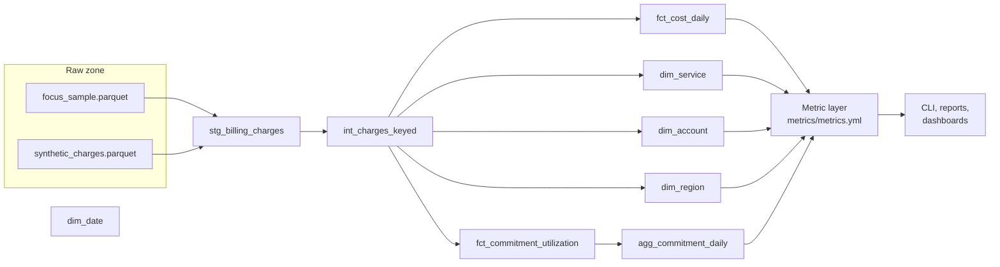

# Architecture

## Data flow

## Layers

| Layer | Models | Materialization | Purpose |
|---|---|---|---|
| Sources | raw zone Parquet files | external | Files written by `finops load-sample` and `finops synthesize`, checked against a manifest |
| Staging | `stg_billing_charges` | view | One typed row per billing line from both sources, in UTC, with `is_synthetic` |
| Intermediate | `int_charges_keyed` | view | Hashed service, region and account keys |
| Marts | `dim_*`, `fct_cost_daily`, `fct_commitment_utilization`, `agg_commitment_daily` | table, incremental for `fct_cost_daily` | The tables the metric layer reads |
| Metrics | `metrics/metrics.yml` | compiled SQL | One definition per metric, compiled to a query at any grain |

## Grains

- `fct_cost_daily`: one row per charge date, account, service, region, charge category
  and source dataset. Amounts are `numeric(38, 9)` under an enforced contract.
- `fct_commitment_utilization`: one row per charge date, provider and commitment.
- `agg_commitment_daily`: one row per charge date and provider. See
  [ADR 0001](adr/0001-roll-up-from-additive-parts.md) for why it exists.

## Quality gates

`dbt build` runs model contracts, uniqueness of every grain, not-null and accepted value
tests, and singular tests that reconcile the cost fact to staging, check that synthetic
rows are flagged and keep utilization and coverage within 0 and 1. CI builds the whole
project on DuckDB; the same SQL targets BigQuery with partitioning by charge date and
clustering by service and account.
